# Sistem Perpustakaan


Sistem manajemen perpustakaan **full-stack** yang terdiri dari website admin berbasis Laravel dan aplikasi mobile berbasis Flutter untuk anggota. Kedua platform terhubung melalui REST API dengan autentikasi token menggunakan Laravel Sanctum.

## Fitur Utama

### Aplikasi Mobile (Anggota)

- Login menggunakan autentikasi token yang disimpan secara aman di perangkat.
- **Beranda:** ringkasan pinjaman aktif, slot peminjaman, denda berjalan, jatuh tempo terdekat, buku populer, dan buku terbaru.
- **Katalog:** pencarian buku, filter kategori, infinite scroll, dan detail buku.
- **Peminjaman:** pengajuan peminjaman dan pengembalian dengan validasi dari server.
- **Riwayat transaksi:** menampilkan status peminjaman, penanda keterlambatan, dan estimasi denda.
- Tema glassmorphism dengan dukungan mode terang dan gelap otomatis.

### Website Admin

- **Dashboard:** grafik aktivitas 7/14/30 hari, status transaksi, buku terpopuler, stok menipis, dan peminjaman terlambat.
- **Manajemen buku:** CRUD buku, termasuk upload cover.
- **Manajemen kategori:** tambah, ubah, dan hapus kategori.
- **Manajemen anggota:** CRUD anggota, upload foto, dan pembuatan kode anggota otomatis.
- **Manajemen transaksi:** persetujuan peminjaman, penolakan disertai alasan, dan verifikasi pengembalian.
- **Pengelolaan stok:** stok diperbarui otomatis berdasarkan transaksi.
- **Denda:** perhitungan denda berdasarkan jumlah hari keterlambatan.
- **Laporan:** filter transaksi, export CSV, dan cetak laporan.
- **Tampilan responsif:** tabel menyesuaikan menjadi kartu pada perangkat mobile.
- Dukungan mode terang dan gelap.

## Arsitektur Sistem

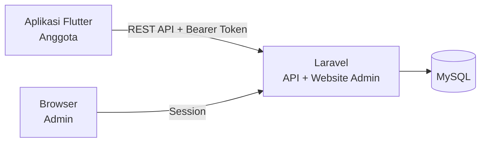

## Alur Status Peminjaman

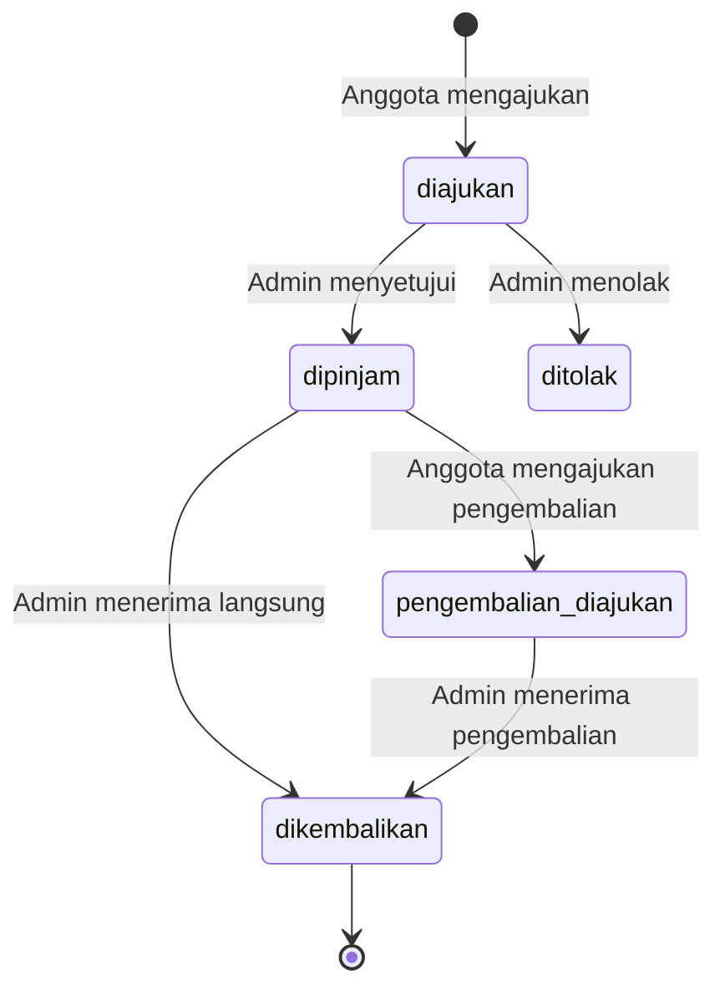

Ketika peminjaman disetujui, stok buku berkurang satu dan tanggal jatuh tempo ditetapkan tujuh hari setelah persetujuan. Ketika pengembalian diterima, stok bertambah kembali dan denda dihitung berdasarkan keterlambatan.

## Entity Relationship Diagram (ERD)

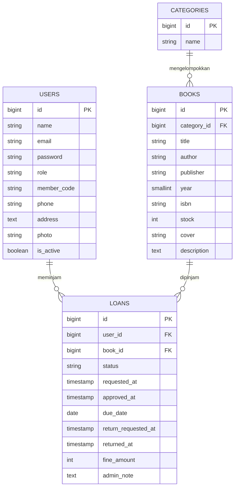

## Teknologi yang Digunakan

| Lapisan | Teknologi |
|---|---|
| Backend | PHP, Laravel, Laravel Sanctum |
| Database | MySQL |
| Website Admin | Blade, Bootstrap 5, Chart.js, CSS |
| Aplikasi Mobile | Flutter, Dart |
| State Management | Provider |
| HTTP Client | Dio |
| Penyimpanan Token | flutter_secure_storage |
| Pengujian Backend | PHPUnit |
| Pengujian Mobile | flutter_test |
| CI/CD | GitHub Actions |

## Menjalankan Proyek

### Prasyarat

- PHP 8.3 atau lebih baru
- Composer
- MySQL (XAMPP juga dapat digunakan)
- Flutter SDK
- Android Studio dan Android Emulator

### 1. Menjalankan Backend

Clone repository:

```bash
git clone https://github.com/fayermenn28/perpustakaan-app.git
cd perpustakaan-app
```

Masuk ke direktori backend:

```bash
cd backend
composer install
```

Buat file konfigurasi environment:

```bash
cp .env.example .env
```

Untuk Windows PowerShell:

```powershell
Copy-Item .env.example .env
```

Buat application key:

```bash
php artisan key:generate
```

Buat database MySQL dengan nama `perpustakaan`, kemudian sesuaikan konfigurasi database pada file `.env`.

Jalankan migrasi dan seeder:

```bash
php artisan migrate --seed
```

Buat symbolic link untuk penyimpanan file:

```bash
php artisan storage:link
```

Jalankan server Laravel:

```bash
php artisan serve
```

Website admin dapat diakses melalui:

`http://localhost:8000`

### 2. Menjalankan Aplikasi Mobile

Buka terminal baru, kemudian masuk ke direktori mobile:

```bash
cd mobile
flutter pub get
flutter run
```

Untuk Android Emulator, alamat backend menggunakan:

`http://10.0.2.2:8000/api`

Untuk menjalankan aplikasi pada HP fisik, jalankan backend dengan:

```bash
php artisan serve --host=0.0.0.0
```

Kemudian jalankan Flutter dengan alamat IP laptop:

```bash
flutter run --dart-define=API_BASE_URL=http://IP_LAPTOP:8000/api
```

Ganti `IP_LAPTOP` dengan alamat IPv4 laptop yang terhubung ke jaringan yang sama dengan HP.

## Akun Demo

Akun berikut digunakan untuk pengembangan dan pengujian lokal.

| Peran | Email | Password |
|---|---|---|
| Admin | admin@perpus.test | password123 |
| Anggota | anggota@perpus.test | password123 |
| Anggota | budi@perpus.test | password123 |
| Anggota | citra@perpus.test | password123 |

**Catatan:** Jangan gunakan akun demo atau password bawaan pada lingkungan produksi.

## REST API

Semua endpoint selain login memerlukan header autentikasi berikut:

```http
Authorization: Bearer <token>
Accept: application/json
```

| Method | Endpoint | Fungsi |
|---|---|---|
| POST | `/api/login` | Login anggota dan mendapatkan token |
| POST | `/api/logout` | Mencabut token aktif |
| GET | `/api/me` | Mendapatkan profil anggota |
| GET | `/api/dashboard` | Mendapatkan ringkasan beranda |
| GET | `/api/categories` | Mendapatkan daftar kategori |
| GET | `/api/books` | Mendapatkan daftar buku |
| GET | `/api/books/{id}` | Mendapatkan detail buku |
| GET | `/api/loans` | Mendapatkan riwayat transaksi |
| POST | `/api/loans` | Mengajukan peminjaman buku |
| POST | `/api/loans/{id}/return` | Mengajukan pengembalian buku |

Parameter yang tersedia pada endpoint katalog meliputi `search`, `category_id`, dan `page`. Endpoint riwayat transaksi mendukung parameter `status` dan `page`.

## Catatan Teknis

- **Konsistensi stok:** proses persetujuan peminjaman dan pengembalian menggunakan database transaction serta row locking (`lockForUpdate`) untuk menjaga konsistensi stok.
- **Status keterlambatan:** dihitung berdasarkan tanggal jatuh tempo, bukan disimpan sebagai status permanen.
- **Perhitungan denda:** denda final ditetapkan ketika pengembalian buku diterima admin.
- **Keamanan akun:** penonaktifan anggota mencabut seluruh token API miliknya.
- **Konfigurasi bisnis:** batas peminjaman, durasi pinjam, denda harian, dan batas stok menipis dikelola melalui `backend/config/library.php`.
- **Respons API:** pesan error menggunakan format yang konsisten agar dapat ditangani oleh aplikasi mobile.

## Pengujian

### Backend

```bash
cd backend
php artisan test
```

Pengujian backend mencakup alur peminjaman dan menggunakan SQLite in-memory sesuai konfigurasi pengujian.

### Mobile

```bash
cd mobile
flutter test
```

## Tangkapan Layar

Tangkapan layar aplikasi akan ditambahkan pada direktori `docs/screenshots/`.

### Website Admin

| Dashboard Terang | Dashboard Gelap |
|---|---|
| 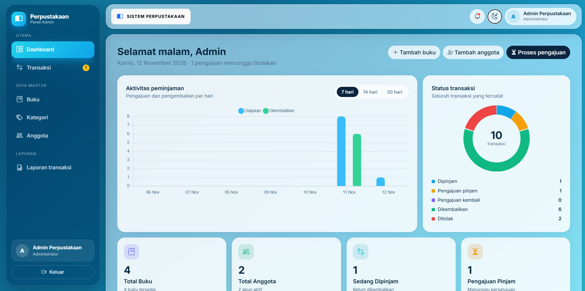 | 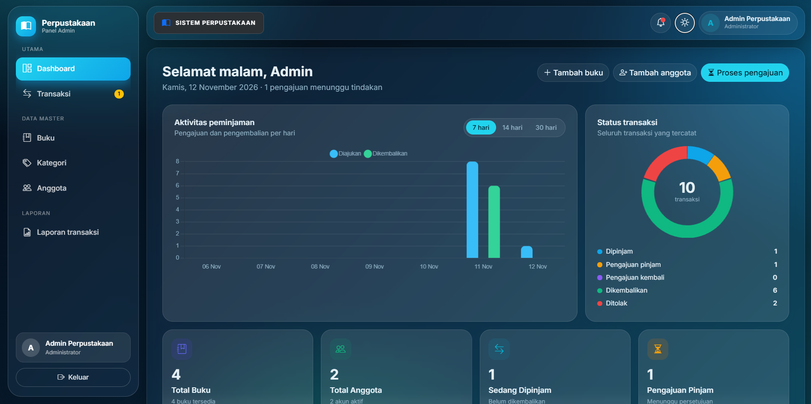 |

| Manajemen Transaksi | Laporan |
|---|---|
| 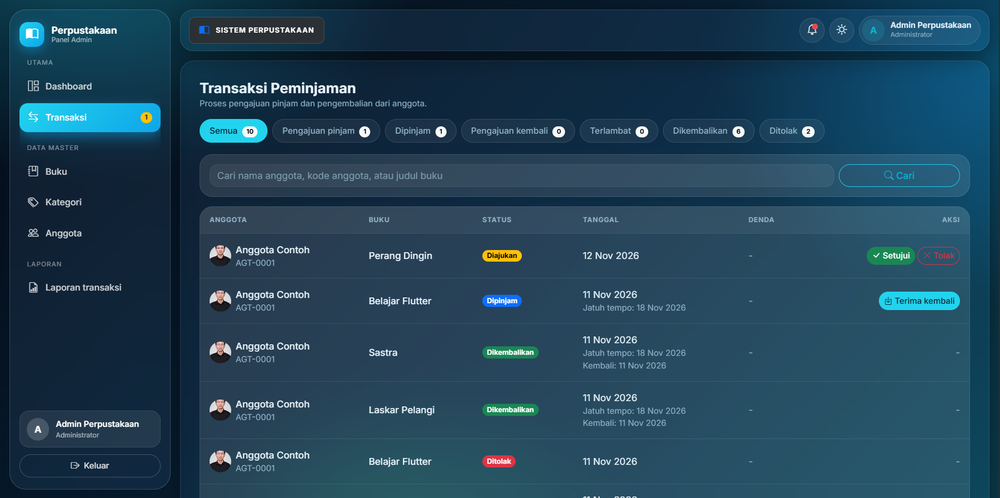 | 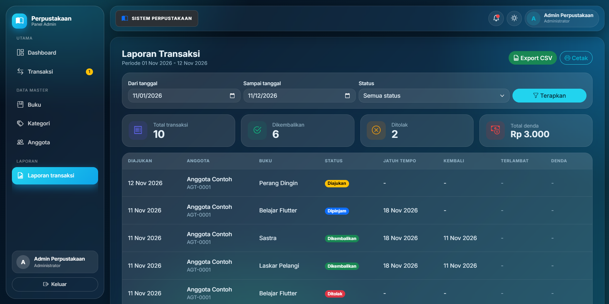 |

### Aplikasi Mobile

| Login | Beranda | Katalog |
|---|---|---|
| 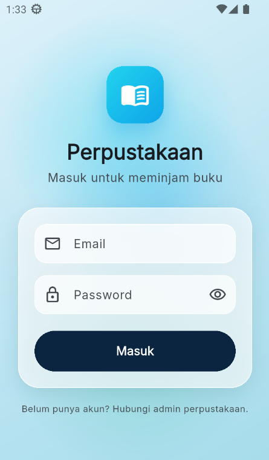 | 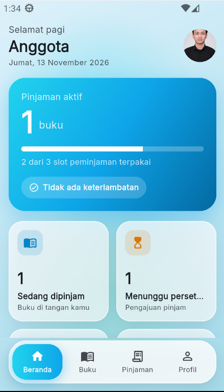 | 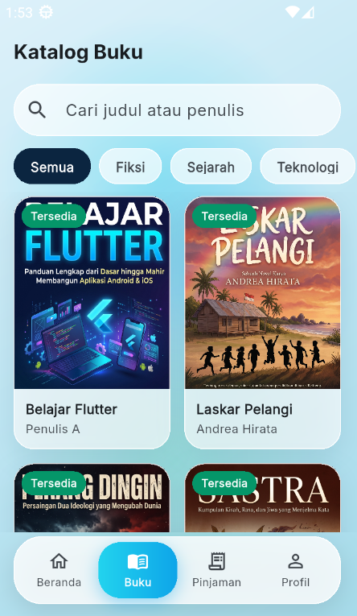 |

| Detail Buku | Pinjaman | Profil |
|---|---|---|
| 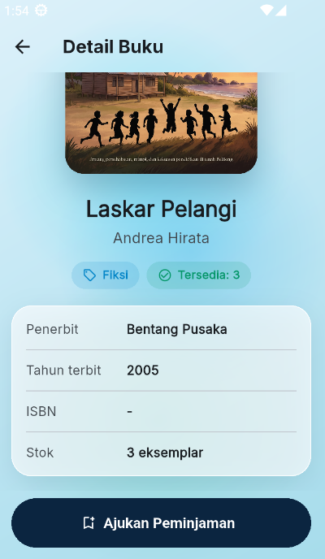 | 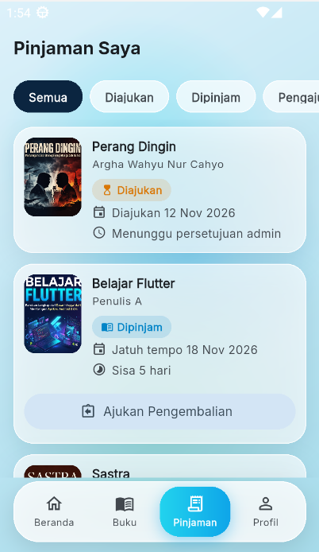 | 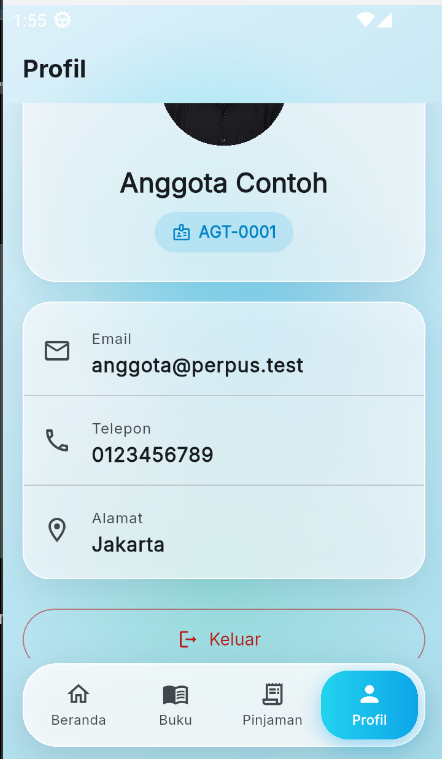 |

## Rencana Pengembangan

- [ ] Notifikasi jatuh tempo dan perubahan status transaksi.
- [ ] Reservasi buku yang stoknya habis.
- [ ] Docker Compose untuk menjalankan seluruh stack dengan satu perintah.
- [ ] Pengembangan pengujian widget Flutter.
- [ ] Lokalisasi pesan validasi ke bahasa Indonesia.

## Lisensi

Proyek ini menggunakan lisensi [MIT](LICENSE).

---

**Dikembangkan oleh Firman Syaputra.**